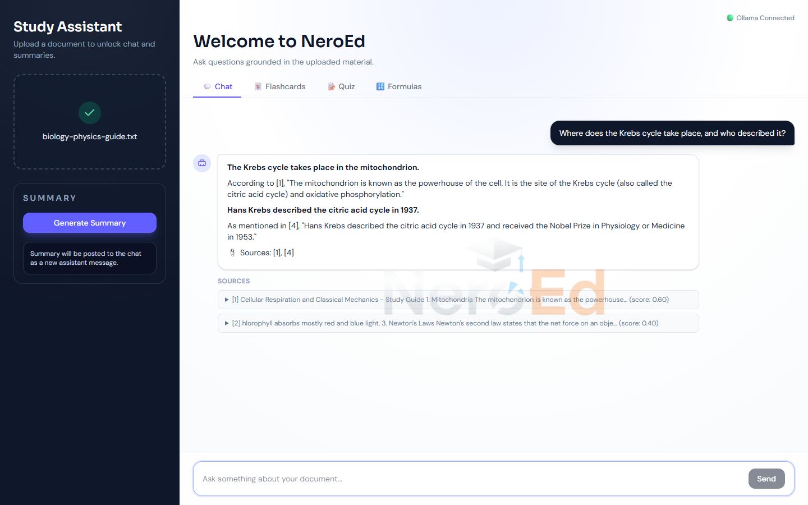
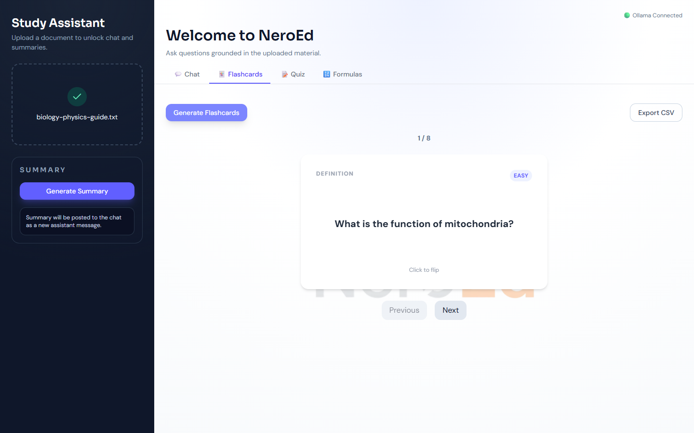
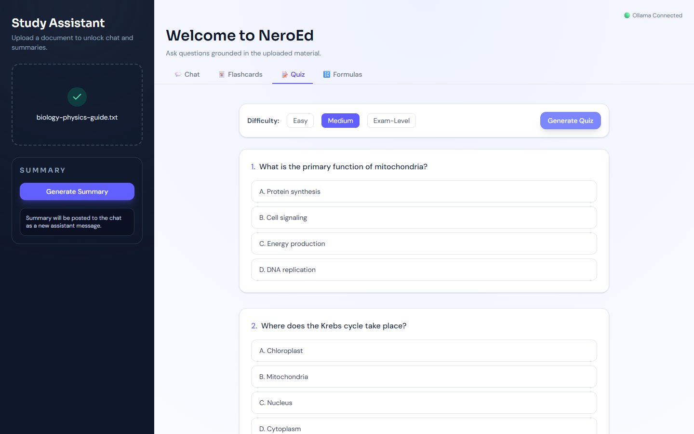
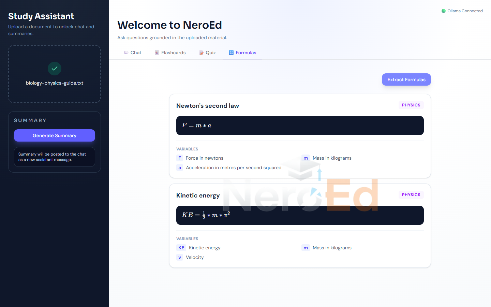
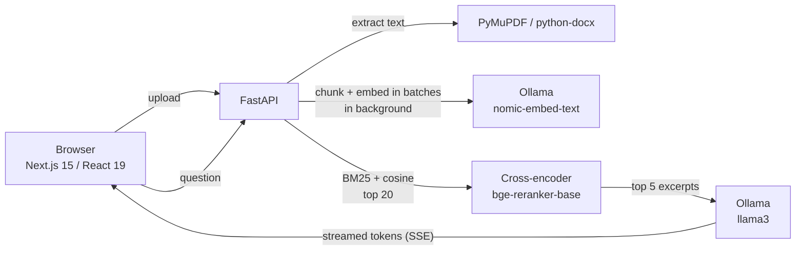

# NeroEd

**An AI study assistant that runs entirely on your machine.** Upload a PDF, DOCX or TXT file and NeroEd turns it into an interactive study workspace: ask questions and get answers grounded in the document with cited sources, or generate summaries, flashcards, quizzes and a formula sheet from the same material.

Everything runs locally through [Ollama](https://ollama.com), so no document ever leaves your computer.



## Features

- **Grounded chat:** answers come only from the uploaded document, with numbered source excerpts. When the document doesn't contain the answer, it says so instead of making one up.
- **Hybrid retrieval:** BM25 keyword search combined with embedding similarity, then reranked with a cross-encoder.
- **Large documents:** a 78 MB, 780-page PDF is indexed in about 25 seconds on a laptop GPU, and questions are answered in under 1 second to the first word.
- **Streaming answers:** tokens stream to the browser as they are generated, using server-sent events.
- **Follow-up questions:** chat history is kept per session, so you can ask "when did he describe it?"
- **Multilingual:** answers in the language of the question (English, French or Arabic).
- **Study tools:**
  - Exam-oriented summaries.
  - Flashcards with flip cards and CSV export.
  - Quizzes (multiple choice, true/false, short answer) at three difficulty levels, with scoring and explanations.
  - Formula extraction rendered with KaTeX, with each variable explained.

For large documents, the study tools read representative passages from the whole file rather than only the first pages. The chunk embeddings are clustered into topics with k-means, and the passage closest to each topic centre is used.

| Flashcards | Quiz |
|---|---|
|  |  |



## How it works



1. **Ingest:** `/upload` extracts the text, splits it into overlapping 500-character chunks, and returns at once. A background task embeds the chunks 64 at a time and builds the search indexes once, while the UI polls `/status` and shows progress.
2. **Retrieve:** each question is scored against every chunk with both BM25 keyword matching (40%) and cosine similarity (60%). The top 20 candidates are reranked by a cross-encoder, and the best 5 become numbered excerpts in the prompt.
3. **Generate:** llama3 answers using only those excerpts, and the reply streams back with its citations.
4. **Study tools:** these send the document, or representative passages of it, to purpose-built prompts. The JSON tools (flashcards, quiz, formulas) run at temperature 0 so they copy from the document rather than improvise.

## Performance

Measured on a laptop with an Intel i5-13500H and an RTX 4060 (8 GB), using generated textbook-style PDFs (about 2,500 characters of text plus one image per page). Each file hides five facts at different depths, and every run below retrieved and answered all five correctly.

| File | Pages | Chunks | Indexing | First word of an answer | Summary |
|---|---|---|---|---|---|
| 4 MB | 40 | 230 | 1.5 s | 0.7 s | 85 s |
| 15 MB | 150 | 862 | 4.7 s | 0.7 s | 84 s |
| 50 MB | 500 | 2,871 | 15.5 s | 0.9 s | 79 s |
| 78 MB | 780 | 4,482 | 24.7 s | 0.9 s | 122 s |

Before the optimizations, the 15 MB file took 33 minutes to index, and each answer took 7–12 seconds to start. These changes made the difference:

- **IPv4 for Ollama:** the client connects to `127.0.0.1` instead of `localhost`. On Windows, `localhost` tries IPv6 first, and Ollama only listens on IPv4, so every request waited about 2 seconds.
- **Batched embeddings:** chunks are embedded 64 per request through one reused connection.
- **Indexes built once:** the embedding matrix and BM25 index are built when the document is uploaded, not on every question.
- **GPU reranker:** the reranker runs on the GPU in half precision when CUDA is available, taking about 35 ms instead of 1.1 s on the CPU.
- **Bounded summaries:** a summary makes at most a handful of model calls, however long the document is.
- **Capped replies:** every model reply stops at 2,048 tokens, so a model that misses its stop token can't run into the request timeout.

These numbers were measured on Ollama 0.24.0. Ollama 0.40.7 generates at the same speed with llama3 but embeds more slowly (the 78 MB file takes about 39 s to index), so there is no reason to update unless you want to try a newer model family. Any Ollama chat model can be used through `NEROED_CHAT_MODEL`.

## Tech stack

| Layer | Technology |
|---|---|
| Frontend | Next.js 15, React 19, TypeScript, Tailwind CSS 4, react-markdown, KaTeX |
| Backend | Python, FastAPI, httpx, PyMuPDF, python-docx, rank-bm25, sentence-transformers, NumPy |
| Models | llama3 (chat), nomic-embed-text (embeddings) via Ollama; BAAI/bge-reranker-base (reranking) |
| Quality | pytest, ruff, mypy, ESLint 9, TypeScript strict mode |

## Getting started

**Prerequisites:** Python 3.10+, Node.js 18.18+, and [Ollama](https://ollama.com).

```bash
# 1. Pull the models and start Ollama
ollama pull llama3
ollama pull nomic-embed-text
ollama serve

# 2. Backend (http://localhost:8000)
cd backend
python -m venv .venv
.venv/Scripts/activate        # macOS/Linux: source .venv/bin/activate
pip install -r requirements.txt
uvicorn main:app --reload

# 3. Frontend (http://localhost:3000)
cd frontend
npm install
npm run dev
```

Open http://localhost:3000 and upload a document of up to 100 MB. The first question takes longer while the reranker model downloads (about 1 GB, one time only).

**NVIDIA GPU (optional, recommended):** the default PyTorch build runs the reranker on the CPU. To run it on the GPU, install the CUDA build:

```bash
pip install --force-reinstall --no-deps torch --index-url https://download.pytorch.org/whl/cu128
```

**Configuration:**

| Variable | Where | Default |
|---|---|---|
| `OLLAMA_URL` | backend | `http://127.0.0.1:11434` |
| `NEROED_CHAT_MODEL` | backend | `llama3` |
| `NEROED_EMBED_MODEL` | backend | `nomic-embed-text` |
| `NEXT_PUBLIC_API_URL` | `frontend/.env.local` | `http://localhost:8000` |

## Testing

The backend has 104 offline tests that use fake models, plus live end-to-end tests against a real Ollama server.

```bash
cd backend
pip install -r requirements-dev.txt
python -m pytest                              # offline suite, about 2 seconds
NEROED_LIVE=1 python -m pytest -m live -v     # live suite, needs Ollama running
```

The tests cover:

- **Text extraction and chunking:** PDF, DOCX and TXT, encoding errors, and chunk overlap.
- **Retrieval:** ranking, score normalization, punctuation-insensitive keyword matching, reranking, and reuse of the prebuilt index.
- **Passage selection for large documents:** topic coverage within the budget, document order, and formula-dense passages.
- **Ollama client:** batching, timeouts, connection errors, model errors in the middle of a stream, and model and context-window settings.
- **API endpoints:** status codes, upload size limit, streaming events, chat history, and CORS.
- **Concurrency:** a test runs a real server and checks that a slow generation doesn't block other requests.
- **Live tests:** grounded answers, follow-up questions, refusing out-of-scope questions, French answers, and every study tool.

Static checks:

```bash
cd backend  && ruff check . && mypy --ignore-missing-imports *.py
cd frontend && npx tsc --noEmit && npm run lint && npm run build
```

## Project structure

```
backend/
  main.py             FastAPI app and endpoints
  ollama_client.py    Ollama client, embeddings, hybrid retrieval, reranking, prompts
  selection.py        picks representative passages from large documents
  extractor.py        PDF/DOCX/TXT extraction and chunking
  session_manager.py  in-memory sessions and chat history
  tests/              pytest suite (offline + live)
frontend/
  app/page.tsx        the study workspace UI
docs/screenshots/     README images
```

## Limitations

- Sessions are kept in memory, so they are lost when the backend restarts. There is no authentication; this is a single-user local tool.
- Scanned PDFs without a text layer are not supported (there is no OCR).
- Answer quality is bounded by the 8B llama3 model. It occasionally cites an excerpt number that doesn't exist.
